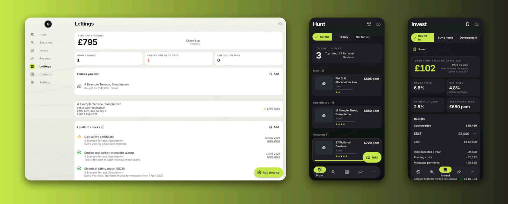
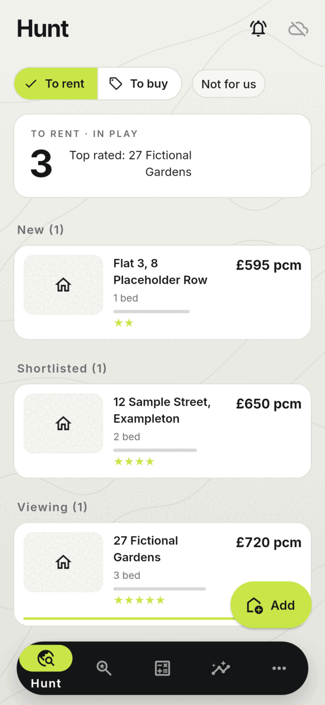
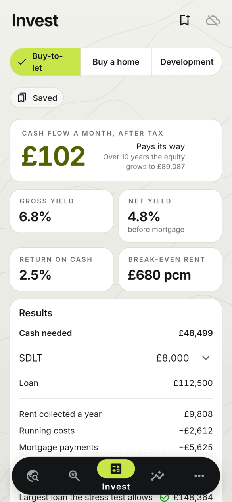
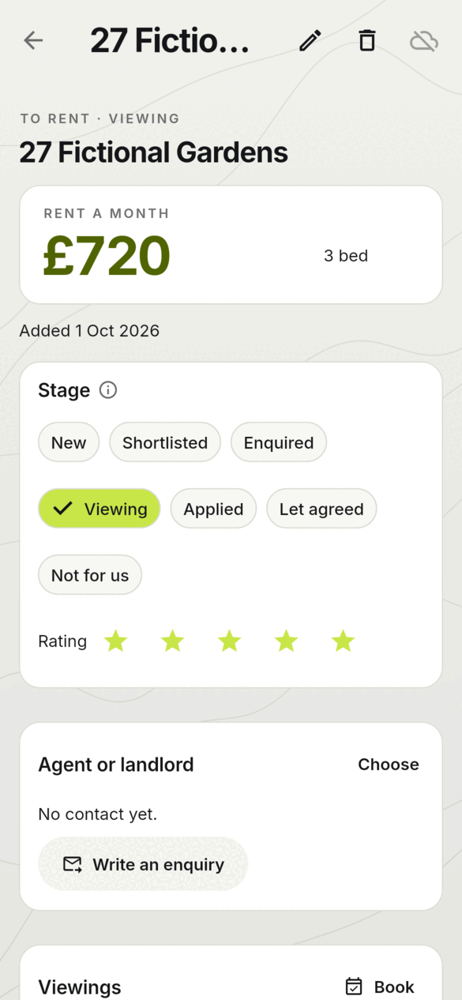
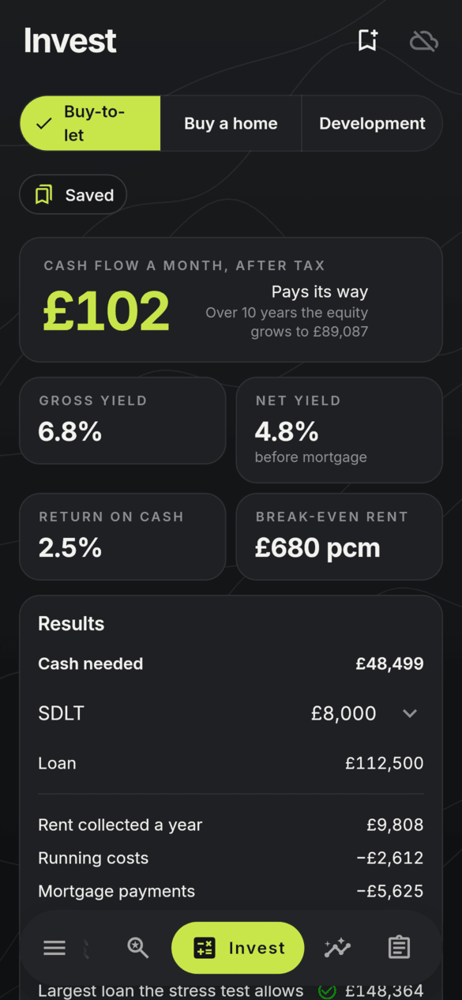
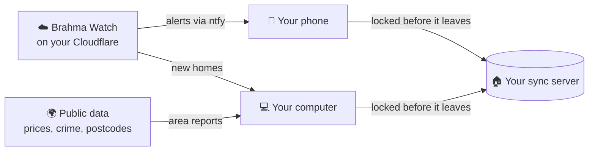

<h1 align="center">
  <br>
  <a href="https://github.com/sudharamachandranrajeev/graha-anveshana"></a>
  <br>
  Graha Anveshana
  <br>
</h1>

<h4 align="center">Find a home to rent or buy, check the numbers and the area, and keep track of homes you let.</h4>

<p align="center">
  <a href="https://github.com/sudharamachandranrajeev/graha-anveshana/releases"></a>
  
  
  <a href="https://github.com/sudharamachandranrajeev/brahma"></a>
</p>

<p align="center">
  <a href="#-what-it-does">What it does</a> •
  <a href="#-get-started">Get started</a> •
  <a href="#-how-it-works">How it works</a> •
  <a href="#-faq-and-troubleshooting">FAQ</a> •
  <a href="#%EF%B8%8F-for-developers">For developers</a>
</p>

<p align="center">
  
</p>

Graha Anveshana is for people hunting for a home in the UK, and for small landlords. It keeps
every home you are looking at, every call to an agent and every sum in one place, on your own
devices. Status: **early test releases**. Tax figures are a starting point for your own checks,
not advice.

## ✨ What it does

- 🏠 **Every home in one list** – homes to rent or buy, grouped by stage: new, shortlisted,
  enquired, viewing, applied, agreed. Add one from a PropertyPal link or type it in.
- 📞 **Contact agents in one tap** – call, text, a chat app or e-mail. Each contact is logged, and a
  ready-made first enquiry carries your details.
- 🔔 **Alerts on your phone** (optional) – your saved searches run on your own free cloud helper,
  Brahma Watch. New homes, price drops and "let" or "sold" notices reach your phone.
- 🧮 **Is it worth it?** – sums for buy-to-let, buying your own home and small developments, with
  current UK purchase tax, mortgage stress tests and rent you need to break even.
- 🗺️ **Know the area** – type any UK postcode for house prices, street crime and recent sales,
  plus links for flood risk, energy ratings, planning and broadband.
- 📋 **Lettings made simple** – tenancies, rent due and paid, deposits, and landlord safety checks
  that remind you when they come round again.
- 🔒 **Private by default** – data is encrypted on the device. Sync is optional, and one account
  works in every Brahma app.
- 🎨 **Easy to read** – big clear figures, light and dark themes, and a hint beside every
  control.

<details>
<summary>Full list of what the sums and reports cover</summary>

| Area | What is included |
| --- | --- |
| Buy-to-let | Purchase tax with surcharges, gross and net yield, cash flow, Section 24, company ownership, lender stress test, break-even rent, equity over time |
| Buying a home | Affordability, stressed payments, owning against renting, letting it out later |
| Development | Gross development value, build and finance costs, profit, residual land value (the most you could pay for the land) |
| Purchase tax | Stamp Duty (England, Northern Ireland), LBTT (Scotland), LTT (Wales), rates as of October 2026 |
| Area report | UK House Price Index for the council area and nation, street-level crime (not Scotland), sold prices (England and Wales) |
| Landlord checks | Gas safety, electrical report (EICR), energy certificate (EPC), smoke and carbon monoxide alarms, registration and more |

</details>

## 📸 Screenshots

<table>
  <tr>
    <td align="center"><br><sub>Hunt</sub></td>
    <td align="center"><br><sub>Invest (buy-to-let)</sub></td>
    <td align="center"><br><sub>Lettings (dark)</sub></td>
  </tr>
  <tr>
    <td align="center"><br><sub>A home</sub></td>
    <td align="center"><br><sub>Hunt (dark)</sub></td>
    <td align="center"><br><sub>Invest (dark)</sub></td>
  </tr>
</table>

<p align="center">
  <br>
  <sub>Hunt on a desktop window</sub>
</p>

<sub>All screenshots show made-up homes and people, rendered from the app's code.</sub>

## 🚀 Get started

### Step 1 – Download

Open the [releases page](https://github.com/sudharamachandranrajeev/graha-anveshana/releases)
and, under the newest release, pick the file for your device:

| Your device | File to download | Works on |
| --- | --- | --- |
| 🐧 Linux computer | `Graha-Anveshana-<version>-linux-x64.tar.gz` | Ubuntu 24.04, Fedora, Arch and similar (64-bit x86) |
| 🪟 Windows computer | `Graha-Anveshana-<version>-windows-x64-setup.exe` | Windows 10 and 11 |
| 🤖 Android phone | `Graha-Anveshana-<version>-android.apk` | Android 7 and newer |

Each release also has `SHA256SUMS.txt`, a list of fingerprints to check the files are genuine.

### Step 2 – Install

<details>
<summary><b>🐧 Linux</b></summary>

1. Open a terminal in the folder where the download landed.
2. Unpack it and run the installer as your normal user (not `sudo`):
   ```sh
   tar -xzf Graha-Anveshana-*-linux-x64.tar.gz
   cd anveshana-*-linux-x64 && ./install.sh
   ```
3. Open **Graha Anveshana** from your app menu.

It installs for your user only. It needs GTK 3, libsecret and the desktop keyring (the app that
stores passwords) running. To remove it later: `./install.sh --uninstall`. Your data stays.

</details>

<details>
<summary><b>🪟 Windows</b></summary>

1. Double-click `Graha-Anveshana-<version>-windows-x64-setup.exe`. No admin rights needed.
2. Windows may say *"Windows protected your PC"*. This appears because the app isn't paid-signed
   yet, not because it is harmful. Click **More info → Run anyway**.
3. Follow the installer, then open **Graha Anveshana** from the Start menu.

Prefer no installer? Download `…-windows-x64-portable.zip`, unzip it anywhere and run
`anveshana.exe`.

</details>

<details>
<summary><b>🤖 Android</b></summary>

1. Open the downloaded `.apk` on your phone.
2. If Android asks, allow installs from your browser or file manager. This is normal for apps
   from outside an app store.
3. Tap **Install**, then **Open**.

Newer versions install over the top and keep your data.

</details>

### Step 3 – First launch

The app opens on **Hunt**. Every screen works empty, so there is nothing to fill in first.

1. **Add your details**: open **Settings → Your details → Edit**. Your name, phone and household
   go into enquiries you send.
2. **Set a home point**: **Settings → Home point → Set**, then type a postcode. Distances are
   measured from here.
3. **Add a home**: on **Hunt**, tap **Add** and paste a PropertyPal link, or type the home in.
4. **Contact the agent** from the home's page. The home moves to the next stage by itself.

> [!NOTE]
> The next release opens with a short welcome. It asks where your data should live: on this
> device only, or synced through a home or cloud server. It also adds an app lock (PIN or
> fingerprint), a tip at the top of each screen, **Ask AI** for help finding your way, and
> **Report a problem**.

### Step 4 (optional) – Phone alerts with Brahma Watch

Brahma Watch runs your saved searches on your own free Cloudflare account. It alerts your phone
through [ntfy](https://ntfy.sh), a free notification app. You need a computer with Git and
Node.js for about ten minutes.

1. On the computer, run:
   ```sh
   git clone https://github.com/sudharamachandranrajeev/brahma.git
   cd brahma/watch && npm install
   npx wrangler login   # once: allow your Cloudflare account in the browser
   npm run setup        # prints the Watch address, its token and an ntfy topic
   ```
2. On your phone, install ntfy and subscribe to that topic.
3. In the app, open **Settings → Brahma Watch → Set up** and paste the address and token.
4. On **Searches**, tap **Add** for each PropertyPal search, then **Send to Watch**. Tap
   **Test alert** to check your phone gets it.

### Step 5 (optional) – Use it on more than one device

Turn on sync in **Settings → Sync**. You need a sync server you own; the
[Brahma sync server guide](https://github.com/sudharamachandranrajeev/brahma/tree/main/server)
walks you through it. **Write down the recovery key** it shows and keep it safe.

## 🧭 How it works



- **On each device**, the app keeps your data in an encrypted database. Without your key it is
  unreadable.
- **Sync is optional.** With it, each device locks its changes before sending them. The server
  cannot read them.
- **Brahma Watch** checks your searches on a schedule. The app sends it your searches and
  brings in what it found each time it starts.
- **What leaves the device on its own**: postcodes (to postcodes.io and public data sites), the
  PropertyPal links you add, and Watch requests. Nothing else unless you turn on sync.

> [!IMPORTANT]
> Your password and recovery key are the only ways to unlock synced data. If you lose both, nobody
> can recover it. On Android, uninstalling the app deletes its data, so sync first.

## ❓ FAQ and troubleshooting

<details>
<summary><b>Do I need an account or the internet?</b></summary>

No account. The lists, sums and lettings work offline on one device. Adding a PropertyPal link,
area reports and alerts need the internet.
</details>

<details>
<summary><b>Windows says the app might be unsafe</b></summary>

The build isn't code-signed (a paid certificate). Click **More info → Run anyway**. Check the file
against `SHA256SUMS.txt` on the release if you want to be sure it is genuine.
</details>

<details>
<summary><b>Linux: the app stops at start and talks about a missing key</b></summary>

The key that unlocks your data lives in the desktop keyring. Make sure your keyring app is
running and unlocked, then start the app again.
</details>

<details>
<summary><b>Which property sites work?</b></summary>

Links and saved searches work with PropertyPal. For a home from any other site, add it by hand on
**Hunt → Add**.
</details>

<details>
<summary><b>Where is my data stored?</b></summary>

Linux: `~/.local/share/dev.brahma.anveshana`. Windows: in your user's AppData folder. Android:
inside the app. Uninstalling on Linux or Windows leaves it in place.
</details>

<details>
<summary><b>I saved cars in version 0.2.0. Where are they?</b></summary>

Cars moved to their own app, [Vahana Anveshana](https://github.com/sudharamachandranrajeev/vahana-anveshana).
Add them again there from their advert links.
</details>

## 🛠️ For developers

<details>
<summary>Build from source, test and release</summary>

You need [Git](https://git-scm.com) and [Flutter](https://flutter.dev) 3.47.

```bash
git clone https://github.com/sudharamachandranrajeev/graha-anveshana
cd graha-anveshana
flutter pub get
flutter run -d linux        # or windows, or an Android device

flutter analyze && flutter test                                       # check and test
GRAHA_SHOTS=/tmp/shots flutter test test/screenshots_test.dart        # render the screenshots
scripts/make-icons.sh                                                 # app icons from branding/anveshana.svg
```

- `brahma_core` comes from the [brahma](https://github.com/sudharamachandranrajeev/brahma) repo.
  To work on both at once, add a `pubspec_overrides.yaml` (ignored by git) with
  `dependency_overrides: brahma_core: path: ../brahma/core`.
- CI runs analyse and test on each push. A `v*` tag builds, smoke-tests and publishes the
  Android, Windows and Linux builds (`.github/workflows/release.yml`).
- Changes per version: [CHANGELOG.md](CHANGELOG.md).

</details>

<details>
<summary>Credits</summary>

- [Flutter](https://flutter.dev) and [Riverpod](https://riverpod.dev)
- [drift](https://drift.simonbinder.eu) over SQLite3MultipleCiphers (through brahma_core) for the
  encrypted database
- [http](https://pub.dev/packages/http), [intl](https://pub.dev/packages/intl),
  [url_launcher](https://pub.dev/packages/url_launcher)
- [Inter](https://rsms.me/inter/) font (SIL Open Font License, `assets/fonts/Inter-OFL.txt`)
- [ntfy](https://ntfy.sh) for Brahma Watch alerts
- Open data: [UK House Price Index](https://www.gov.uk/government/collections/uk-house-price-index-reports),
  [police.uk](https://data.police.uk),
  [Price Paid Data](https://www.gov.uk/government/collections/price-paid-data),
  [postcodes.io](https://postcodes.io)

</details>

## Related

Graha Anveshana is one app in the **Brahma** family. They share one sign-in and one sync server.

| App | What it does |
| --- | --- |
| [brahma](https://github.com/sudharamachandranrajeev/brahma) | The shared core, the all-in-one app and Brahma Watch |
| [artha](https://github.com/sudharamachandranrajeev/artha) | Money: accounts, spending, bills and investments |
| [vahana-anveshana](https://github.com/sudharamachandranrajeev/vahana-anveshana) | Find a car |
| [udyoga](https://github.com/sudharamachandranrajeev/udyoga) | Career and job hunting |
| [vidya](https://github.com/sudharamachandranrajeev/vidya) | Learning, flashcards and focus |

## License

No licence has been chosen yet; all rights reserved. Inter is under the SIL Open Font License.

---

> GitHub [@sudharamachandranrajeev](https://github.com/sudharamachandranrajeev)
